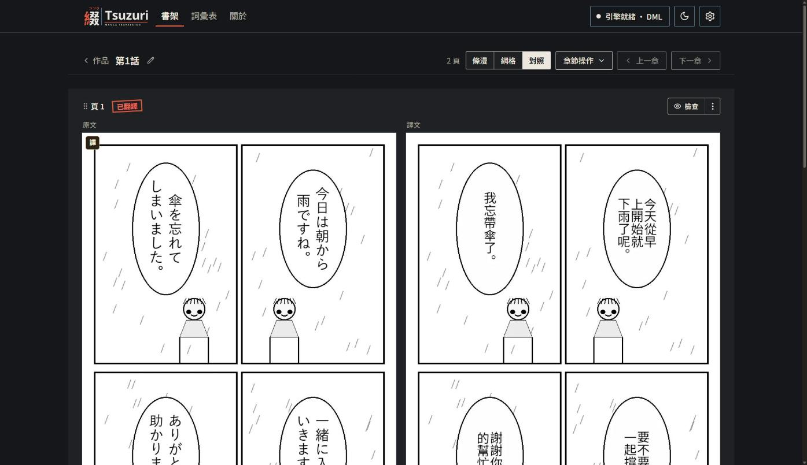
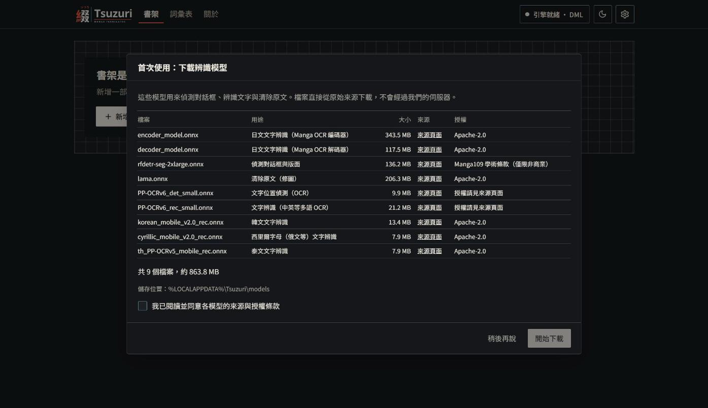
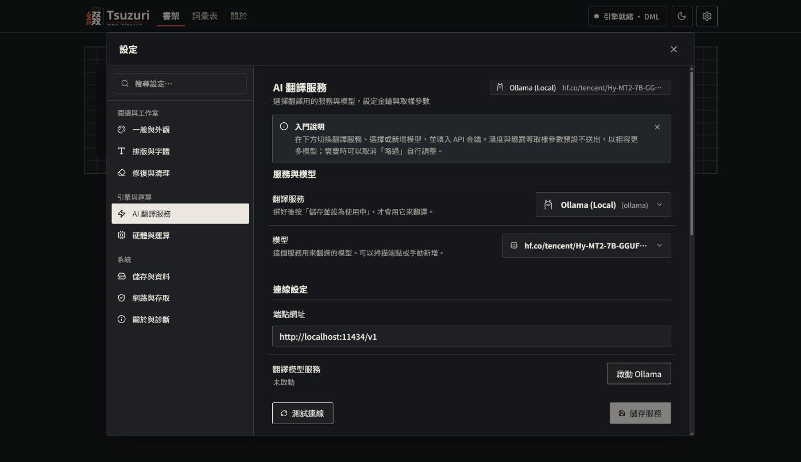
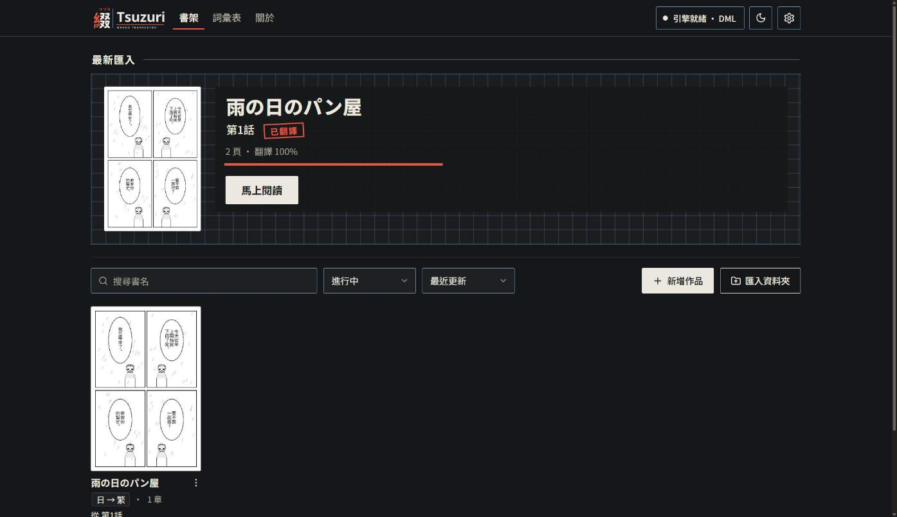

# Tsuzuri

在漫畫網頁上一鍵匯入整章，或右鍵翻譯單張圖片，在你自己的電腦上翻成繁體中文。

- **匯入一章**：在漫畫網頁按一下擴充功能圖示，整章匯入並自動翻譯。→ [怎麼用](#匯入一章)
- **翻譯單張圖片**：在網頁的漫畫圖片上按右鍵，譯圖直接蓋在原圖上。→ [怎麼用](#翻譯單張圖片)
- **用手機閱讀**：手機和電腦連同一個 Wi-Fi，掃 QR Code 就能在手機上連續閱讀翻好的章節。→ [怎麼用](#用手機閱讀)

預設使用本機翻譯模型，圖片和文字不會上傳到任何雲端服務。若你自己改用 Claude CLI 或 Codex CLI 翻譯，漫畫上的文字會送到 Anthropic 或 OpenAI，見[用 Claude / Codex CLI 翻譯](#用-claude--codex-cli-翻譯選用)。



每一頁自動完成：偵測對話框 → 辨識文字 → 翻譯 → 清除原文 → 把譯文排回畫面。

## 需求

| 項目 | 需求 |
| --- | --- |
| 系統 | Windows 10 / 11，64 位元 |
| 記憶體 | 建議 16 GB |
| 顯示卡 | 選用；沒有時以 CPU 執行 |
| 硬碟空間 | 約 8 GB（程式與辨識模型約 2 GB，翻譯模型約 5 GB；只用 CLI 翻譯時可省下翻譯模型） |
| 瀏覽器 | Chrome、Edge 或 Brave |

## 安裝

### 1. 下載並執行

從 [Releases](../../releases) 下載 `Tsuzuri-<版本>-win-x64.zip`，解壓縮後執行 `Tsuzuri.exe`。瀏覽器會開啟 `http://127.0.0.1:8124`。

### 2. 下載辨識模型

第一次啟動會跳出辨識模型的下載視窗。確認來源與授權後同意，程式下載約 860 MB 並檢查檔案；可以中途取消，下次從中斷處繼續。



### 3. 安裝翻譯模型

Tsuzuri 不附翻譯模型，需要自備。

1. 安裝 [Ollama](https://ollama.com/)。
2. 開啟「命令提示字元」，貼上下面這行，下載建議模型 [Hy-MT2-7B](https://huggingface.co/tencent/Hy-MT2-7B-GGUF)（Q4_K_M，約 4.6 GB，Apache-2.0）：

   ```
   ollama pull hf.co/tencent/Hy-MT2-7B-GGUF:Q4_K_M
   ```

3. 在 Tsuzuri 開「設定」→「AI 翻譯服務」，選 Ollama 與這個模型。



### 4. 安裝瀏覽器擴充功能

擴充功能在 zip 裡的 `extension\tsuzuri-importer`。

1. 開啟 `chrome://extensions`，打開「開發人員模式」。
2. 「載入未封裝項目」→ 選 `extension\tsuzuri-importer`。
3. 在 Tsuzuri 的「設定」→「網路與存取」複製存取權杖，貼到擴充功能，只需一次。

## 用法

使用擴充功能時，`Tsuzuri.exe` 需要保持執行中。

### 匯入一章

1. 在瀏覽器打開漫畫的章節閱讀頁，等圖片載入完成。
2. 按工具列上的 Tsuzuri 圖示。擴充功能會列出這一頁的漫畫圖片；長條漫畫可以按「快速掃描」，讓它自動捲動並載入全部圖片。
3. 選「目標作品」和「目標章節」。還沒有這部作品時，按「建立新作品」，並選原文語言（日文或英文）。
4. 在縮圖中取消不需要的圖片（例如廣告），再按「匯入選取的頁面」。
5. 「自動翻譯」預設開啟，匯入完成後會自動翻譯。按「開啟工作台」可以到 Tsuzuri 查看進度與結果。

打開「原地翻譯」時，翻譯好的頁面會直接替換閱讀頁上的原圖。



### 翻譯單張圖片

在網頁的圖片上按右鍵，選「Tsuzuri：翻譯這張圖片」。圖片上方會顯示進度，翻譯完成後，譯圖會直接蓋在原圖上。原文語言預設為日文，可以在擴充功能的設定（齒輪按鈕）中修改，也可以在那裡關閉這個功能。

### 用手機閱讀

1. 在電腦開啟「設定」→「網路與存取」，開啟「區域網路存取」；若顯示需要重新啟動，重新啟動 Tsuzuri。
2. 手機與電腦連到同一個 Wi-Fi。在同一頁的「手機閱讀」掃描 QR Code，用手機瀏覽器開啟連結。
3. 開啟手機書架，選作品與起始章節。直向、橫向都能閱讀；持續向下滑會自動接續下一話，最後顯示返回主畫面或書架的入口。

QR Code 含存取憑證，請勿分享。電腦與 Tsuzuri 必須保持開啟；本功能不提供雲端或外網轉接。如果連不上，請確認手機與電腦在同一個 Wi-Fi，並檢查 Windows 防火牆與路由器的「AP 隔離／裝置隔離」設定。缺少譯圖的頁面會顯示提示，不會自動翻譯，也不會略過。手機只能閱讀，翻譯請在電腦上進行。

## 用 Claude / Codex CLI 翻譯（選用）

如果你已經安裝並登入 [Claude Code](https://docs.anthropic.com/en/docs/claude-code) 或 [Codex CLI](https://github.com/openai/codex)，Tsuzuri 可以在每次翻譯時呼叫它們，不必另外準備翻譯模型。預設仍是本機模型，不會自動切換。

> **文字會離開這台電腦。** 使用這兩個選項時，漫畫上辨識出的文字會經由你已登入的 CLI 送到 Anthropic（Claude）或 OpenAI（Codex）。用量算在 CLI 登入的帳號，可能是訂閱額度，也可能是 API 計費。圖片本身不會送出；偵測、辨識和擦字仍在你的電腦上完成。

1. 先在命令提示字元執行 `claude` 或 `codex`，確認已登入。
2. 開啟「設定」→「AI 翻譯服務」，選「Claude CLI」或「Codex CLI」。找不到 CLI 時，畫面會提示。
3. 選模型（Claude：haiku、sonnet、opus，預設 haiku；Codex：gpt-6.1-terra、gpt-6.1-sol、gpt-6-luna，預設 gpt-6.1-terra），按「測試連線」，再設為使用中。

限制：

- 使用 CLI 時，溫度、Top-P 等取樣設定不會生效，設定頁會自動隱藏這些項目。
- 每次請求有 180 秒上限，同時最多 2 個請求。
- 翻譯速度和品質取決於你選的模型與 CLI 帳號，Tsuzuri 不保證。
- 請自行確認你的 CLI 帳號條款允許這種用法。

## 進階

- 開啟 Tsuzuri 時會自動啟動設定好的 llama.cpp 或 Ollama；可在「設定」→「AI 翻譯服務」關閉。
- 也可以改用 llama.cpp、LM Studio 或其他 OpenAI 相容服務，在同一頁設定。
- llama.cpp 的預設啟動參數採用騰訊建議的 Hy-MT2 取樣設定（temp 0.7、top-p 0.6、top-k 20、repeat penalty 1.05），可在「設定」修改。

## 資料位置

| 內容 | 位置 |
| --- | --- |
| 書庫、設定、翻譯結果 | `%APPDATA%\Tsuzuri` |
| 辨識模型 | `%LOCALAPPDATA%\Tsuzuri\models` |

## 使用須知

Tsuzuri 是在自己電腦上使用的個人翻譯與語言學習輔助工具。

- **尊重原作者**：我們尊重漫畫家、作者與出版社的創作、心血與智慧財產權。
- **支持正版**：請購買正版，或在授權平台上閱讀（例如 MANGA Plus by Shueisha、BOOK☆WALKER、LINE WEBTOON，或各出版社的官方電子書），直接支持作者。
- **在本機執行**：Tsuzuri 不在任何公開伺服器上存放、轉發或抓取有版權的作品。圖片處理、文字辨識與清除原文都在你的電腦上完成；使用本機翻譯模型時，翻譯也在你的電腦上完成；改用 Claude / Codex CLI 時，文字會送到對應的服務。
- **不破解保護**：Tsuzuri 沒有任何繞過加密、數位版權管理（DRM）或付費牆的功能。
- **使用者責任**：請自行確認你的使用方式符合當地法律、合理使用規範，以及來源網站的使用條款。本專案不支持、也不協助任何未經授權的商業轉發。

## 授權

衍生自 Arben Apura 的 [XianScan](https://github.com/ArbenApura/xianscan-rust)，MIT 授權，見 [LICENSE](LICENSE)。第三方元件授權見 [THIRD_PARTY_LICENSES.md](THIRD_PARTY_LICENSES.md)。

模型與字型不在 MIT 授權範圍內，各有自己的授權，來源與條款見 [NOTICE.md](NOTICE.md)。
